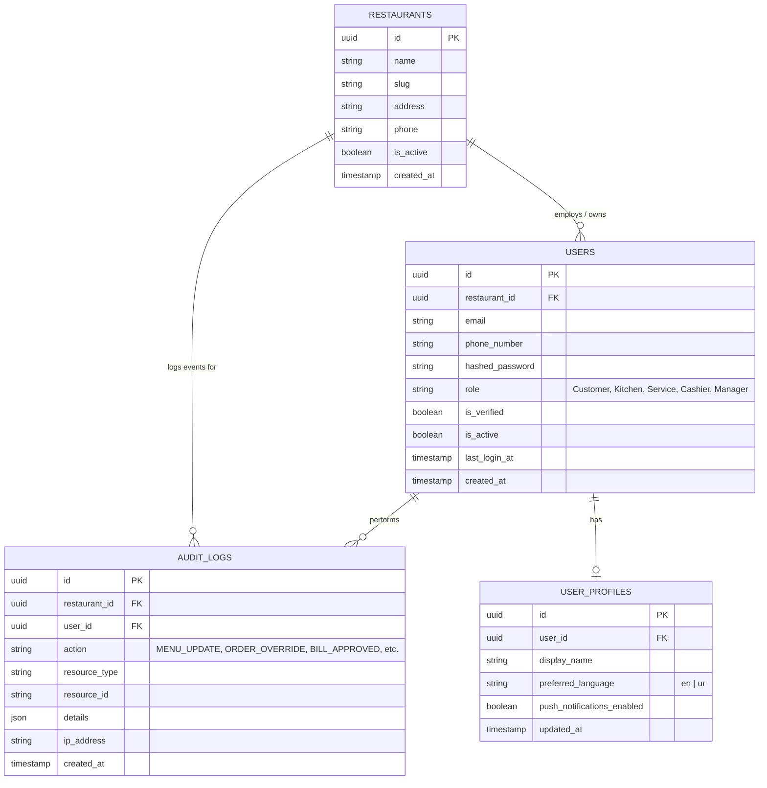
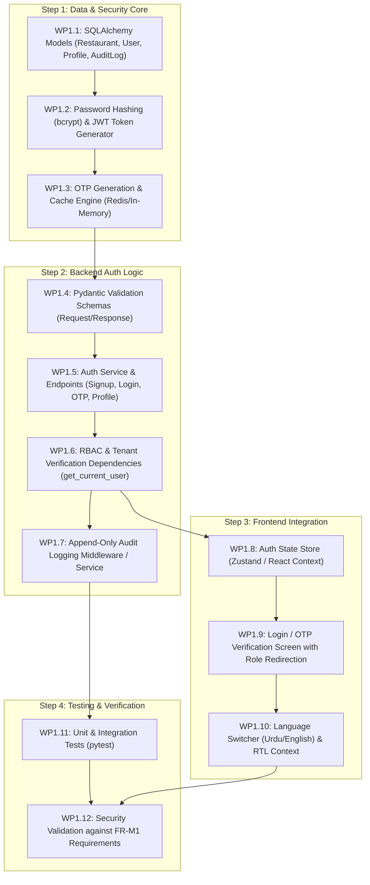

# MezFlow — Module 1: Identity & Access Control
## Implementation Plan (`M1_implementation_plan.md`)

- **Project:** MezFlow — Real-Time Restaurant Dining and Kitchen Operations Management System
- **Module ID:** M1 (Identity and Access Control)
- **Phase:** FYP-I
- **Owner:** Sheikh Muhammad Khizar
- **Document Version:** 1.0
- **Target Location:** `Docs/Plan/M1_implementation_plan.md`
- **SRS Requirements Covered:** `FR-M1-01` through `FR-M1-07`
- **Traceability:** `NFR-07` (Access Security & RBAC), `NFR-08` (Multi-tenant isolation), `NFR-10` (Append-only Auditability), `NFR-12` (Language/Localisation).

---

## 1. Module Overview & Goals

Module 1 is the security backbone of MezFlow. It controls who can access the system, what operations they are authorized to perform, and ensures complete data separation between different restaurants.

### Core Objectives:
1. **User Authentication**: Dual-method authentication supporting Password + OTP verification via phone or email (`FR-M1-01`).
2. **Session Management**: Secure, stateless JWT (JSON Web Tokens) with expiration and inactivity limits (`FR-M1-02`).
3. **Role-Based Access Control (RBAC)**: Strict enforcement across 5 distinct system roles across all REST endpoints and WebSocket channels (`FR-M1-03`):
   - `Customer`
   - `Kitchen Staff`
   - `Service Staff`
   - `Cashier`
   - `Manager`
4. **User Preferences**: Profile configuration for language (`English` vs `Urdu`) and notification preferences (`FR-M1-04`).
5. **Cryptographic Security**: Passwords salted and hashed with `bcrypt`; never logged or returned in plain text (`FR-M1-05`).
6. **Append-Only Audit Trail**: Immutable logging of administrative and operational actions (`FR-M1-06`).
7. **Tenant Isolation**: Restaurant-level partitioning so users can never view or modify data belonging to another restaurant (`FR-M1-07`).

---

## 2. Database Schema (M1 Specific)



---

## 3. API Contract Specification (M1 Endpoints)

All endpoints are prefixed with `/api/v1/auth`.

| Method | Endpoint | Access Level | Description |
| :--- | :--- | :--- | :--- |
| `POST` | `/api/v1/auth/signup` | Public | Customer or staff registration (creates unverified account). |
| `POST` | `/api/v1/auth/request-otp` | Public | Dispatches OTP to email or phone number. |
| `POST` | `/api/v1/auth/verify-otp` | Public | Verifies OTP code; returns access token if login. |
| `POST` | `/api/v1/auth/login` | Public | Authenticates using email/phone + password; returns JWT. |
| `POST` | `/api/v1/auth/refresh` | Authenticated | Refreshes active JWT before expiration. |
| `GET` | `/api/v1/auth/me` | Authenticated | Returns current authenticated user and profile. |
| `PATCH` | `/api/v1/auth/profile` | Authenticated | Updates display name, preferred language, or notification settings. |
| `GET` | `/api/v1/auth/audit-logs` | Manager only | Retrieves audit log entries for the tenant restaurant. |

---

## 4. Implementation Steps & Work Packages



---

### Step 1: Data & Security Core
- **WP1.1 Models**: Define `User`, `UserProfile`, `Restaurant`, and `AuditLog` in `backend/app/models/`. Enforce non-nullable constraints and unique indexes on `(restaurant_id, email)` and `(restaurant_id, phone_number)`.
- **WP1.2 Cryptography**: Implement `verify_password()` and `get_password_hash()` in `backend/app/core/security.py` using `passlib[bcrypt]`. Implement `create_access_token()` using `python-jose` with configurable expiry (`ACCESS_TOKEN_EXPIRE_MINUTES`).
- **WP1.3 OTP Service**: Implement 6-digit OTP generator with 5-minute time-to-live (TTL). For local development, log the OTP code to terminal; build interface ready for SMS/Email providers.

---

### Step 2: Backend Auth Services & RBAC
- **WP1.4 Schemas**:
  - `UserCreate`, `UserLogin`, `Token`, `OTPRequest`, `OTPVerify`, `UserProfileUpdate`, `UserResponse`.
- **WP1.5 Endpoints**:
  - Implement `/auth/signup`, `/auth/login`, `/auth/request-otp`, `/auth/verify-otp`, and `/auth/me`.
- **WP1.6 RBAC Dependencies**:
  - Create `get_current_user` dependency extracting JWT from HTTP Bearer header.
  - Create reusable role enforcement dependency:
    ```python
    def require_role(allowed_roles: list[str]):
        async def dependency(current_user: User = Depends(get_current_user)):
            if current_user.role not in allowed_roles:
                raise HTTPException(status_code=403, detail="Forbidden: Insufficient privileges")
            return current_user
        return dependency
    ```
  - Enforce tenant verification so users cannot access data across different `restaurant_id` instances (`FR-M1-07`).
- **WP1.7 Audit Service**:
  - Implement `record_audit_log(db, restaurant_id, user_id, action, resource_type, details)` ensuring logs cannot be modified or deleted via API.

---

### Step 3: Frontend Auth & User Profile UI
- **WP1.8 Auth Store**:
  - Create Zustand auth store managing `token`, `user`, `role`, and `isAuthenticated`.
  - Persist tokens in secure HTTP-only cookies or encrypted localStorage.
- **WP1.9 Login & Verification UI**:
  - Tabbed authentication UI:
    - Tab 1: Email + Password login.
    - Tab 2: Mobile Number + 6-digit OTP input.
  - Role-based automatic redirect:
    - `Customer` ➔ `/r/{restaurantId}/t/{tableId}` (Customer Menu)
    - `Kitchen Staff` ➔ `/kds` (Kitchen Display)
    - `Manager` ➔ `/admin/dashboard` (Management Console)
- **WP1.10 Language & Localization**:
  - Implement UI language context supporting `en` (English) and `ur` (Urdu).
  - Configure automatic `dir="rtl"` attribute when Urdu is selected (`FR-M1-04`, `NFR-12`).

---

### Step 4: Verification & Acceptance Tests

| Test ID | Objective | Expected Result |
| :--- | :--- | :--- |
| `TEST-M1-01` | Register user and hash password | Stored password begins with `$2b$` (bcrypt), plain text never saved. |
| `TEST-M1-02` | Request and verify OTP | Valid OTP issues JWT token; expired or invalid OTP returns `400 Bad Request`. |
| `TEST-M1-03` | Role-based endpoint enforcement | `Customer` role attempting to access `/kds` or `/admin` receives `403 Forbidden`. |
| `TEST-M1-04` | Multi-tenant isolation | User from Restaurant A cannot query orders or users from Restaurant B (`404` or `403`). |
| `TEST-M1-05` | Audit trail creation | Triggering a protected action automatically writes an entry in `audit_logs`. |
| `TEST-M1-06` | Language preference toggle | Selecting Urdu switches profile language to `ur` and applies RTL layout. |

---

## 5. Definition of Done (DoD) for Module 1

Module 1 is complete when:
- [x] Users can sign up, log in with password or OTP, and receive a signed JWT token.
- [x] Role restrictions are strictly enforced on backend endpoints with 100% test coverage.
- [x] Multi-tenant isolation prevents cross-restaurant data leaks.
- [x] Profile updates allow saving language preference (`English` vs `Urdu`).
- [x] Audit logs record all privileged user actions in an append-only format.
- [x] Frontend login page works cleanly and redirects users based on their role.
