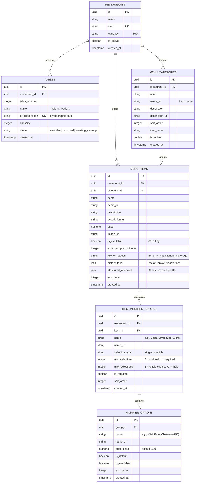

# MezFlow — Module 2: Digital Menu & QR Table Access
## Implementation Plan (`M2_implementation_plan.md`)

- **Project:** MezFlow — Real-Time Restaurant Dining and Kitchen Operations Management System
- **Module ID:** M2 (Digital Menu and QR Table Access)
- **Phase:** FYP-I (25% Milestone Deliverable alongside M1 & M3)
- **Owner:** Syed Sail Haider Gardezi
- **Document Version:** 1.0
- **Target Location:** `Docs/Plan/M2_implementation_plan.md`
- **SRS Requirements Covered:** `FR-M2-01` through `FR-M2-06` (Digital Menu, Table QR Verification, Structured Modifiers, Real-Time Availability & Price Sync, Dietary & Station Metadata, Bilingual English/Urdu Menu)
- **Traceability:** `NFR-01` (First Load < 3s on Mobile), `NFR-02` (Real-Time Latency < 2s), `NFR-06` (Server Price Integrity), `NFR-08` (Multi-tenant Isolation), `NFR-11` (SUS Score $\ge$ 70), `NFR-12` (Language & RTL Localisation), `NFR-15` (Zero-Install Mobile PWA).

---

## 1. Module Overview & Goals

Module 2 is the primary customer-facing entry point of MezFlow. It enables diners to scan a physical table QR code, instantly access a rich, mobile-optimized digital menu in their mobile browser without installing any app, customize their dishes with structured modifiers, and observe real-time availability changes (such as 86ed items or price adjustments) pushed directly from the kitchen or manager console.

### Core Objectives:
1. **Zero-Install QR Table Access (`FR-M2-01`, `NFR-15`)**:
   - Each physical table is assigned a unique, cryptographically secure QR code token.
   - Scanning the QR code routes directly to `https://<domain>/r/{restaurant_slug}/t/{table_token}`.
   - The browser loads the Customer Progressive Web App (PWA) in under 3 seconds on typical mobile cellular connections (`NFR-01`).
2. **Hierarchical Categorized Menu Engine (`FR-M2-02`)**:
   - Menu items organized cleanly into sortable categories (e.g., Starters, BBQ & Grill, Traditional Karahi, Fast Food, Beverages, Desserts).
   - Display covers dish name, high-resolution visual preview, description, base price in restaurant currency (PKR), estimated preparation time, and kitchen preparation station.
3. **Structured Item Modifiers (`FR-M2-03`, `NFR-06`)**:
   - Robust customization engine supporting single-choice groups (e.g., portion size: Half vs Full), required choices (e.g., spice level: Mild, Medium, Hot), optional add-ons with price deltas (e.g., extra cheese +150 PKR), and ingredient removals (e.g., no onions).
   - Server-enforced modifier bounds (minimum and maximum selection limits) ensuring pricing integrity.
4. **Real-Time Menu & Availability Synchronization (`FR-M2-04`, `NFR-02`)**:
   - Instant broadcast of item availability toggles (e.g., when kitchen runs out of a dish and marks it 86ed) and price changes over WebSockets/Redis Pub/Sub.
   - Active diners see the item card immediately disabled or labeled "Sold Out" without needing to reload or pull-to-refresh.
5. **Dietary, Station & AI Preparation Metadata (`FR-M2-05`)**:
   - Visual badges for dietary attributes (Vegetarian, Halal, Spicy Index, Allergens).
   - Internal kitchen station routing (Grill, Fry, Hot Kitchen, Beverage) and expected preparation minutes to power M4 (KDS) and M6 (Delay Tracking).
   - Structured attribute payload (`flavor`, `texture`, `portion_size`, `heat_level`, `ingredients`) to feed M7 Grounded AI Dish Explanations.
6. **Bilingual Localization & Accessibility (`FR-M2-06`, `NFR-12`, `NFR-11`)**:
   - Native bilingual support for English and Urdu across all category names, dish descriptions, and modifier choices.
   - Dynamic Right-to-Left (RTL) layout switching with typographic hierarchy (Inter & Noto Sans Arabic/Urdu) and touch-friendly targets ($\ge$ 44px).
7. **Table QR Administration & Export (`FR-M2-07`)**:
   - Management console capabilities for restaurant managers to create tables, regenerate tokens, and export high-resolution printable table QR stand graphics (SVG/PNG).

---

## 2. Database Schema (M2 Specific)



---

## 3. API Contract Specification (M2 Endpoints)

### 3.1 Public Customer Endpoints (Zero Authentication Required)
Customer endpoints are accessible by anyone scanning a tabletop QR code. All queries are strictly scoped by the verified `restaurant_id` extracted from the table token or URL.

| Method | Endpoint | Query / Path Params | Purpose & Response |
| :--- | :--- | :--- | :--- |
| `GET` | `/api/v1/tables/lookup/{qr_code_token}` | Path: `qr_code_token` | **Table QR Verification**: Validates table code, returns restaurant ID, slug, name, table ID, table number, and current table status. |
| `GET` | `/api/v1/restaurants/{restaurant_id}/menu` | Path: `restaurant_id`<br>Query: `lang` (`en`\|`ur`) | **Public Digital Menu**: Returns active categories and available items, including prices, badges, images, and embedded modifier group summaries. |
| `GET` | `/api/v1/restaurants/{restaurant_id}/menu/items/{item_id}` | Path: `restaurant_id`, `item_id`<br>Query: `lang` (`en`\|`ur`) | **Dish Customization Details**: Returns complete item specifications, full modifier groups, options with price deltas, and structured attributes. |
| `GET` | `/api/v1/restaurants/{restaurant_id}/menu/search` | Query: `q`, `category_id`, `station`, `dietary` | **Menu Filter & Search**: Instant autocomplete search across English & Urdu dish names and tags. |
| `WS` | `/ws/restaurants/{restaurant_id}/menu` | Path: `restaurant_id`<br>Query: `token` (optional) | **Live Menu Real-Time Sync**: Pushes real-time `MENU_ITEM_UPDATED`, `ITEM_AVAILABILITY_CHANGED` (86ed), and `CATEGORY_UPDATED` events. |

### 3.2 Protected Manager Endpoints (Role: `Manager` Required)
Administrative endpoints allow restaurant managers to configure tables, generate QR graphics, edit categories, dishes, and modifier groups (`FR-M1-03`, `FR-M1-06`).

| Method | Endpoint | Access Level | Purpose & Action |
| :--- | :--- | :--- | :--- |
| `GET` | `/api/v1/tables` | Manager | Lists all tables for the manager's restaurant with status and QR tokens. |
| `POST` | `/api/v1/tables` | Manager | Creates a new physical table and generates a unique QR code token. |
| `GET` | `/api/v1/tables/{table_id}/qr` | Manager | Generates printable SVG/PNG QR stand graphic with table number & restaurant branding. |
| `POST` | `/api/v1/tables/{table_id}/regenerate-qr` | Manager | Invalidates existing QR token and generates a fresh token (e.g., if token leaked). |
| `POST` | `/api/v1/menu/categories` | Manager | Creates a new menu category with sort order and Urdu translation. |
| `PATCH` | `/api/v1/menu/categories/{category_id}` | Manager | Updates category details or sort order. |
| `DELETE` | `/api/v1/menu/categories/{category_id}` | Manager | Soft-deletes / deactivates category. |
| `POST` | `/api/v1/menu/items` | Manager | Creates a new menu item with pricing, station, and structured AI attributes. |
| `PATCH` | `/api/v1/menu/items/{item_id}` | Manager | Updates item details, price, or prep time. Triggers audit log and live WS broadcast. |
| `PATCH` | `/api/v1/menu/items/{item_id}/availability` | Manager / Kitchen | **Instant 86 Toggle**: Toggles `is_available` boolean. Triggers instant WS push (`< 2s`). |
| `POST` | `/api/v1/menu/items/{item_id}/modifier-groups` | Manager | Adds a customization modifier group to a dish (e.g. Spice Level, Extra Toppings). |
| `POST` | `/api/v1/menu/modifier-groups/{group_id}/options` | Manager | Adds modifier options with price deltas (e.g. Extra Cheese +150 PKR). |
| `PATCH` | `/api/v1/menu/modifier-options/{option_id}` | Manager | Updates option name, price delta, or option availability. |

---

## 4. Implementation Steps & Work Packages

```mermaid
flowchart TD
    subgraph Step 1: Database & Data Modeling
        WP2_1["WP2.1: Modifier Models & Alembic Migration"]
        WP2_2["WP2.2: Pydantic Schemas for Menu, Modifiers & Table QR"]
    end

    subgraph Step 2: Backend Menu & Table Services
        WP2_3["WP2.3: Table QR Service & Cryptographic Token Generator"]
        WP2_4["WP2.4: Public Menu API & Hierarchical Query Service"]
        WP2_5["WP2.5: Manager Menu & Modifier Administration Endpoints"]
        WP2_6["WP2.6: Real-Time Menu WebSocket & Redis Broadcast Engine"]
    end

    subgraph Step 3: Frontend Customer PWA (Zero-Install Diner UI)
        WP2_7["WP2.7: Dynamic Table Route & QR Token Session Resolver"]
        WP2_8["WP2.8: Sticky Category Navigation Bar with Scrollspy"]
        WP2_9["WP2.9: Dish Card Component with Badges & Availability Overlay"]
        WP2_10["WP2.10: Interactive Dish Customization Modal & Modifier Bottom Sheet"]
        WP2_11["WP2.11: Live Menu Sync Hook (WebSocket Auto-Reconnection)"]
        WP2_12["WP2.12: Urdu Translation & RTL Visual Presentation"]
    end

    subgraph Step 4: Table QR Generation & Management UI
        WP2_13["WP2.13: Manager QR Code Generator & Printable Card Viewer"]
    end

    subgraph Step 5: Testing & Acceptance Verification
        WP2_14["WP2.14: Comprehensive Pytest & Latency Benchmarks"]
    end

    WP2_1 --> WP2_2
    WP2_2 --> WP2_3 --> WP2_4 --> WP2_5 --> WP2_6
    WP2_3 --> WP2_7
    WP2_4 --> WP2_8 --> WP2_9 --> WP2_10
    WP2_6 --> WP2_11
    WP2_10 --> WP2_12
    WP2_5 --> WP2_13
    WP2_11 --> WP2_14
    WP2_12 --> WP2_14
    WP2_13 --> WP2_14
```

---

### Step 1: Database & Data Modeling

#### WP2.1: Modifier Models & Alembic Migration
- Extend database models in `backend/app/models/menu.py`:
  - Define `ItemModifierGroup` with columns: `id`, `restaurant_id`, `item_id`, `name`, `name_ur`, `selection_type`, `min_selections`, `max_selections`, `is_required`, `sort_order`.
  - Define `ModifierOption` with columns: `id`, `group_id`, `name`, `name_ur`, `price_delta`, `is_default`, `is_available`, `sort_order`.
  - Update `MenuItem` with `dietary_tags` (`ARRAY` or `JSON`), `name_ur`, and `description_ur`.
  - Update `MenuCategory` with `name_ur`, `description_ur`, and `icon_name`.
- Generate and apply Alembic migration: `backend/alembic/versions/xxxx_m2_menu_modifiers.py`.

#### WP2.2: Pydantic Validation Schemas
- Create schemas in `backend/app/schemas/menu.py`:
  - `TableLookupResponse`: Table status, restaurant branding, session token.
  - `ModifierOptionBase`, `ModifierOptionCreate`, `ModifierOptionResponse`.
  - `ModifierGroupBase`, `ModifierGroupCreate`, `ModifierGroupResponse`.
  - `MenuItemBase`, `MenuItemCreate`, `MenuItemUpdate`, `MenuItemResponse`, `MenuItemDetailResponse`.
  - `MenuCategoryBase`, `MenuCategoryCreate`, `MenuCategoryResponse`, `PublicMenuResponse`.
  - `AvailabilityToggleRequest`: `is_available: bool`.

---

### Step 2: Backend Menu & Table Services

#### WP2.3: Table QR Service & Cryptographic Token Engine
- Create `backend/app/services/table_service.py`:
  - Secure random slug token generation using `secrets.token_urlsafe(16)` with prefix (e.g., `mz-t04-9a8f`).
  - Validation service resolving `qr_code_token` to `(restaurant, table)` with error handling if inactive or invalid.
  - Standalone QR image generator using Python `qrcode` library rendering SVG and PNG data URLs with branded MezFlow styling.

#### WP2.4: Public Menu API & Hierarchical Query Service
- Create `backend/app/services/menu_service.py`:
  - Efficient async query fetching categories joined with active items and modifier group options in a single round-trip.
  - Support for bilingual response rendering based on `Accept-Language` header or `?lang=ur` query parameter.
  - Implement `/api/v1/tables/lookup/{qr_code_token}` and `/api/v1/restaurants/{restaurant_id}/menu`.

#### WP2.5: Manager Menu & Modifier Administration Endpoints
- Implement endpoints in `backend/app/api/v1/endpoints/menu.py`:
  - Full CRUD for categories and items protected by `require_role(["Manager"])`.
  - Dedicated fast endpoint for 86ing items: `PATCH /api/v1/menu/items/{item_id}/availability`.
  - Endpoints to attach modifier groups and options to dishes.
  - Automatic audit log emission for all menu changes (`FR-M1-06`).

#### WP2.6: Real-Time Menu WebSocket & Redis Broadcast Engine
- Create WebSocket endpoint `/ws/restaurants/{restaurant_id}/menu`:
  - Utilizes Redis Pub/Sub channel `channel:menu:{restaurant_id}`.
  - When a manager or chef toggles availability or modifies a price, publishes payload:
    ```json
    {
      "event": "ITEM_AVAILABILITY_CHANGED",
      "item_id": "9b1deb4d-3b7d-4bad-9bdd-2b0d7b3dcb6d",
      "is_available": false,
      "updated_at": "2026-10-22T10:30:00Z"
    }
    ```
  - Broadcasts to all connected diners in $< 2$ seconds (`NFR-02`).

---

### Step 3: Frontend Customer PWA (Zero-Install Diner UI)

#### WP2.7: Dynamic Table Route & QR Token Session Resolver
- Update `frontend/src/app/(customer)/r/[restaurantId]/t/[tableId]/page.tsx`:
  - Client component resolving table QR token via `GET /api/v1/tables/lookup/{token}`.
  - If table valid, load restaurant header with currency, table badge, and menu catalog.
  - If token invalid or table unavailable, render an elegant user-friendly error screen with option to request waiter assistance.

#### WP2.8: Sticky Category Navigation Bar with Scrollspy
- Implement category pill bar:
  - Sticky sub-header with horizontal swipeable pills (Starters, BBQ & Grill, Fast Food, etc.).
  - Smooth scroll to active category section on click.
  - Active category highlight using `IntersectionObserver`.

#### WP2.9: Dish Card Component with Badges & Availability Overlay
- Create `frontend/src/components/customer/DishCard.tsx`:
  - Displays dish thumbnail, English and Urdu titles, price formatted with currency (e.g. `PKR 1,150`).
  - Dietary icons (chili icon for spice level, green leaf for veg, halal badge).
  - Estimated prep time badge (`15 mins`).
  - When `is_available === false`: applies grayscale overlay, disables selection, and displays clear "Currently Sold Out" badge.
  - Primary "Customize & Add" CTA button opening the modifier sheet.

#### WP2.10: Interactive Dish Customization Modal & Modifier Bottom Sheet
- Create `frontend/src/components/customer/ModifierModal.tsx`:
  - Mobile bottom-sheet layout with touch drag-to-dismiss.
  - Radio buttons for single-choice groups (e.g., Spice Level: Mild / Medium / Extra Spicy).
  - Checkboxes for optional add-ons with dynamic price calculation preview (e.g. Base 1190 + Extra Cheese 150 = 1340 PKR).
  - Ingredient removal toggles (e.g., "No Mayo", "No Pickles").
  - Special preparation instructions text box (max 150 characters).
  - Validation: Prevents clicking "Add to Cart" until all required modifier groups satisfy selection rules (`min_selections <= count <= max_selections`).

#### WP2.11: Live Menu Sync Hook (WebSocket Auto-Reconnection)
- Create `frontend/src/hooks/useMenuRealtime.ts`:
  - Establishes WebSocket connection to `/ws/restaurants/{restaurantId}/menu`.
  - Automatically updates local React state when items are 86ed or price is updated without refreshing page.
  - Implements exponential backoff auto-reconnect on cellular network drops (`FR-14`, `NFR-02`).

#### WP2.12: Urdu Translation & RTL Visual Presentation
- Integrate bilingual toggle:
  - Header language switch button (`English` / `اردو`).
  - Swaps dish names, descriptions, and modifier titles to Urdu fields.
  - Applies `dir="rtl"` to dish cards and modal when Urdu is active with Noto Sans Arabic typography.

---

### Step 4: Table QR Generation & Management UI

#### WP2.13: Manager QR Code Generator & Printable Card Viewer
- Create table management view in `frontend/src/app/(admin)/admin/tables/page.tsx`:
  - Table grid with live status indicators (Available, Occupied, Awaiting Cleanup).
  - "Generate QR Card" modal rendering a printable tabletop acrylic card:
    - Restaurant logo and table number.
    - High-density QR code linking to diner URL.
    - Direct "Download SVG / Print PDF" button.

---

### Step 5: Testing & Acceptance Verification

#### WP2.14: Comprehensive Pytest & Latency Benchmarks
- Automated test suite in `backend/tests/test_menu.py`:
  - Verify public menu returns correct hierarchical structure and active categories.
  - Verify manager can create items and modifier groups.
  - Verify required modifier selection validation on the backend.
  - Verify WebSocket broadcast emits event within 2 seconds of 86ing an item.
  - Multi-tenant security check: Restaurant A cannot fetch or mutate Restaurant B's menu items (`NFR-08`).

---

## 5. Verification Matrix & Acceptance Test Cases

| Test ID | Objective | Test Steps | Expected Result |
| :--- | :--- | :--- | :--- |
| `TEST-M2-01` | **Table QR Verification** | Query `/api/v1/tables/lookup/{valid_token}` and `/lookup/invalid_token`. | Valid returns HTTP 200 with restaurant & table data; invalid returns HTTP 404 with error message. |
| `TEST-M2-02` | **Public Menu Structure** | Query `/api/v1/restaurants/{id}/menu`. | Returns list of categories ordered by `sort_order`, with nested items and modifier group schemas. |
| `TEST-M2-03` | **Instant 86ing Broadcast** | Connect customer client to `/ws/restaurants/{id}/menu`. Manager sets `is_available=false`. | WS message received in $< 2$ seconds. Item instantly shows "Sold Out" on customer screen without reload. |
| `TEST-M2-04` | **Modifier Rule Enforcement** | Attempt to configure dish without selecting a required modifier group (e.g., spice level). | Modal highlights missing selection; Add button remains disabled until valid choice is made. |
| `TEST-M2-05` | **Multi-Tenant Menu Isolation** | Manager of Restaurant 1 attempts to modify item belonging to Restaurant 2. | Backend returns `403 Forbidden` or `404 Not Found`; no cross-tenant modification permitted. |
| `TEST-M2-06` | **Urdu & RTL Switch** | Toggle language to Urdu on customer menu screen. | Titles switch to `name_ur`, layout switches to `dir="rtl"`, currency displayed in Urdu script (`روپیہ`). |
| `TEST-M2-07` | **Mobile Performance (<3s)** | Run mobile viewport audit with throttled 3G/4G network profile. | First Contentful Paint $< 1.8$s, interactive digital menu ready in $< 3.0$s (`NFR-01`). |

---

## 6. Definition of Done (DoD) for Module 2

Module 2 is complete and ready for handoff to Module 3 (Collaborative Ordering) when:
- [ ] Unique tabletop QR codes can be generated, verified, and exported as printable graphics for every restaurant table.
- [ ] Public customer menu endpoint returns categories, items, and modifier groups with sub-100ms backend response time.
- [ ] Mobile PWA renders categories, dish cards, and dietary badges with a sticky scrollspy navigation bar.
- [ ] Dish customization bottom-sheet allows selecting single-choice, multi-choice, and ingredient removal modifiers with live price preview.
- [ ] Manager can toggle item availability (86ing), and all connected customer screens receive the update over WebSockets in $< 2$ seconds without refreshing.
- [ ] English and Urdu bilingual toggles work seamlessly with proper RTL alignment and typography.
- [ ] Multi-tenant isolation is strictly enforced across all menu and table data models.
- [ ] All unit, API, and integration tests in `backend/tests/test_menu.py` pass with 100% success rate.
