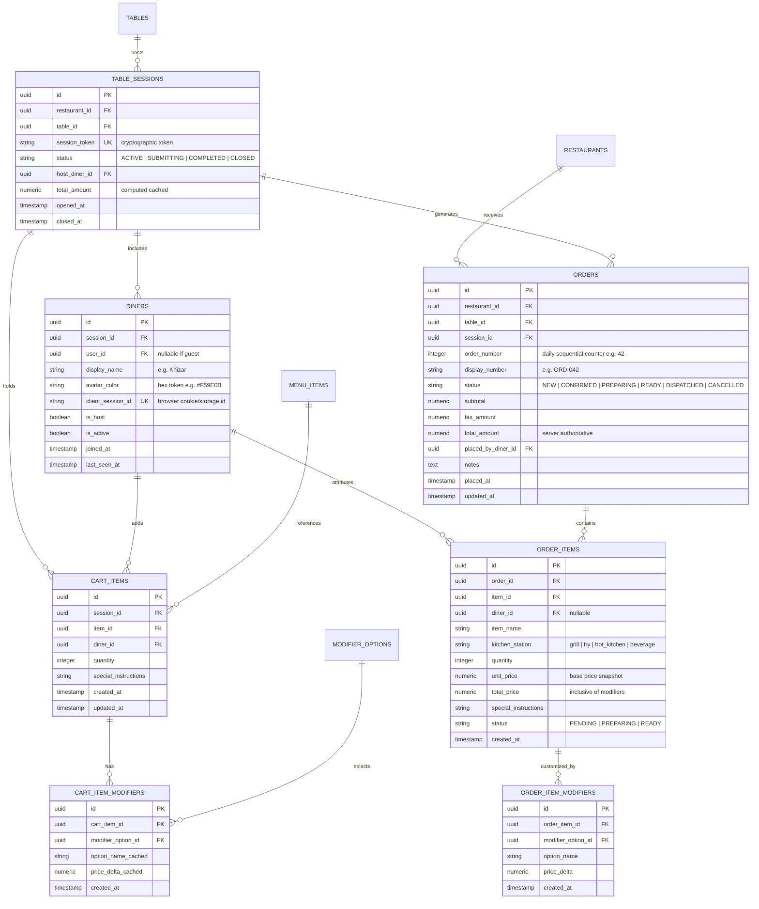
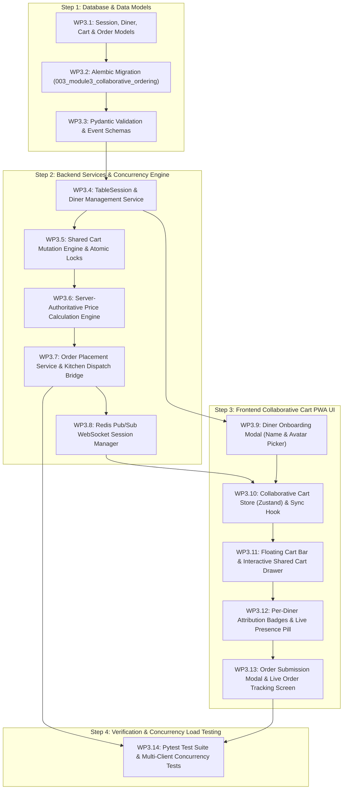

# MezFlow — Module 3: Collaborative Table Ordering & Real-Time Shared Cart
## Implementation Plan (`M3_implementation_plan.md`)

- **Project:** MezFlow — Real-Time Restaurant Dining and Kitchen Operations Management System
- **Module ID:** M3 (Collaborative Table Ordering & Real-Time Cart)
- **Phase:** FYP-I (Final Module of the 25% Mid-Phase Deliverable alongside M1 & M2)
- **Owners:** Syed Sail Haider Gardezi (Frontend Collaborative Cart UX) & Talha Mumtaz (Backend Real-Time WebSocket & Concurrency) & Sheikh Muhammad Khizar (Data Integrity & Architecture)
- **Document Version:** 1.0
- **Target Location:** `Docs/Plan/M3_implementation_plan.md`
- **SRS Requirements Covered:** `FR-M3-01` through `FR-M3-08` (Table Session Joining, Per-Diner Attribution, Real-Time Cart Sync, Multi-Client Concurrency, Server-Authoritative Price Engine, Single Order Submission, Live Order Tracker, Flaky Connection Resynchronization)
- **Traceability:** `NFR-01` (First Load < 3s), `NFR-02` (Real-Time Propagation < 2s), `NFR-03` ($\ge 50$ Concurrent WebSocket Connections), `NFR-04` ($\ge 10$ Simultaneous Table Orders in 2-min Window without State Corruption), `NFR-06` (Server-Authoritative Price Calculation & Security), `NFR-08` (Multi-Tenant Restaurant Isolation), `NFR-11` (SUS Usability $\ge 70$), `NFR-12` (Bilingual English/Urdu & RTL).

---

## 1. Module Overview & Goals

Module 3 delivers the signature interactive capability of MezFlow: **Zero-Install Collaborative Table Ordering**. When a group of diners sits at a table and scans the physical table QR code, they join a single, unified dining session. Rather than passing one phone around or placing fragmented separate tickets, everyone at the table browses the digital menu on their own mobile devices, adds dishes customized with structured modifiers, and sees each other's selections appear in real time with clear visual attribution.

When the group is ready, any diner (or designated host) submits the collective order with a single tap. The server validates the prices, generates the authoritative kitchen order ticket, and dispatches it immediately to the Kitchen Display System (M4), while diners watch the live order state transition from their phones.

```
Diner 1 Scans QR ────┐
                     ▼
Diner 2 Scans QR ──► [Active Table Session] ◄── Real-Time Shared Cart (WebSockets / Redis)
                     ▲     (Per-Diner Badges)
Diner 3 Scans QR ────┘
                               │
                       [Submit Collective Order]
                               │
               ┌───────────────┴───────────────┐
               ▼                               ▼
       [Server Validation]             [Kitchen Order (M4 KDS)]
    (Recomputes all prices;             (Station Routing & Prep
    locks cart; creates Order)           Counters Initialized)
```

### Core Objectives:
1. **Dynamic Table Session Creation & Joining (`FR-M3-01`)**:
   - The first diner scanning a table QR code initializes an active `TableSession` (or reconnects to an active one).
   - Subsequent diners scanning the same table join the identical session automatically.
   - Table status seamlessly transitions from `AVAILABLE` to `OCCUPIED`.
2. **Per-Diner Presence & Attribution (`FR-M3-02`)**:
   - Diners select a friendly display name (e.g. "Khizar", "Talha", "Sail") or inherit their authenticated customer profile.
   - Assigned a distinct avatar color badge.
   - Every cart item displays who added it, providing social clarity during group dining.
3. **Sub-2-Second Real-Time Cart Synchronization (`FR-M3-03`, `NFR-02`)**:
   - Item additions, modifier changes, quantity adjustments, removals, and special cooking notes are instantly broadcast to all connected devices at the table via WebSockets and Redis Pub/Sub.
4. **Multi-Client Concurrency & Race-Condition Immunity (`FR-M3-04`, `NFR-03`, `NFR-04`)**:
   - Prevents phantom items, lost updates, or duplicate submissions when multiple diners interact simultaneously.
   - Atomic database transactions and optimistic locking on cart modifications.
5. **Server-Authoritative Pricing & Security (`FR-M3-05`, `NFR-06`)**:
   - The server strictly ignores client-sent prices. Base dish prices and modifier option deltas are queried directly from the database at submission time.
6. **Unified Single Order Submission (`FR-M3-06`)**:
   - Converts the collective cart into an official `Order` record with a sequential human-readable daily order number (e.g., `#042`).
   - Locks the cart to prevent double ordering.
   - Broadcasts order creation to table diners and kitchen staff.
7. **Live Post-Submission Order Status Tracking (`FR-M3-07`)**:
   - Real-time order progress timeline (`New` ➔ `Confirmed` ➔ `Preparing` ➔ `Ready` ➔ `Dispatched`).
   - Diners can start subsequent ordering rounds (e.g., desserts, extra drinks) within the same session.
8. **Network Resilience & State Resynchronization (`FR-M3-08`, `NFR-02`, `NFR-24`)**:
   - Automatic reconnect with exponential backoff on cellular dropouts; pulls the authoritative cart snapshot immediately upon reconnection.

---

## 2. Database Schema (M3 Specific)



---

## 3. API Contract Specification (M3 Endpoints)

### 3.1 REST Endpoints (Dining Sessions & Cart Operations)

All session and cart endpoints operate without requiring customer account registration; they are securely bound to `session_token` and `client_session_id` cookies/headers.

| Method | Endpoint | Query / Body Params | Description & Response |
| :--- | :--- | :--- | :--- |
| `POST` | `/api/v1/sessions/join` | Body: `{ qr_code_token, display_name, client_session_id? }` | **Join / Create Session**: Resolves table from QR token, creates or joins active `TableSession`, returns session details, diner profile, and active cart. |
| `GET` | `/api/v1/sessions/{session_id}/cart` | Header: `X-Diner-ID` | **Fetch Authoritative Cart**: Returns all items grouped or flat, per-diner attribution, calculated subtotals, and active diner participant list. |
| `POST` | `/api/v1/sessions/{session_id}/cart/items` | Body: `{ item_id, quantity, selected_modifier_option_ids, special_instructions }`<br>Header: `X-Diner-ID` | **Add Item to Shared Cart**: Validates item availability (not 86ed) and modifier rules; atomically adds item; broadcasts `CART_UPDATED` event to table. |
| `PATCH` | `/api/v1/sessions/{session_id}/cart/items/{cart_item_id}` | Body: `{ quantity?, special_instructions? }`<br>Header: `X-Diner-ID` | **Update Cart Item**: Modifies quantity or cooking notes; broadcasts update to all table participants. |
| `DELETE` | `/api/v1/sessions/{session_id}/cart/items/{cart_item_id}` | Header: `X-Diner-ID` | **Remove Cart Item**: Deletes item from collective cart; broadcasts deletion event. |
| `DELETE` | `/api/v1/sessions/{session_id}/cart` | Header: `X-Diner-ID` | **Clear Collective Cart**: Empties shared cart; broadcasts `CART_CLEARED` event. |
| `POST` | `/api/v1/sessions/{session_id}/submit` | Body: `{ notes? }`<br>Header: `X-Diner-ID` | **Submit Order to Kitchen**: Recomputes all prices from DB; creates `Order` & `OrderItem` records; marks cart `SUBMITTED`; broadcasts `ORDER_PLACED` to table and KDS. |
| `GET` | `/api/v1/sessions/{session_id}/orders` | None | **List Table Orders**: Returns orders placed during this session with live status, timestamps, and item breakdowns. |

---

### 3.2 Real-Time WebSocket Channel Specification

**WebSocket Endpoint:** `/ws/sessions/{session_id}` (and fallback `/api/v1/ws/sessions/{session_id}`)  
**Authentication & Identity:** Query params `?diner_id={diner_id}&token={session_token}`  
**Redis Channel Pattern:** `channel:session:{session_id}`

#### Client-Bound Events (Server $\rightarrow$ Diners):

1. **`DINER_JOINED`**:
   ```json
   {
     "event": "DINER_JOINED",
     "session_id": "8c45...",
     "diner": {
       "id": "e12f...",
       "display_name": "Sail",
       "avatar_color": "#10B981",
       "is_host": false
     },
     "active_diners_count": 3
   }
   ```
2. **`CART_UPDATED`** (Item added, updated, or removed):
   ```json
   {
     "event": "CART_UPDATED",
     "session_id": "8c45...",
     "action": "ITEM_ADDED",
     "actor_diner_name": "Khizar",
     "item": {
       "cart_item_id": "c01b...",
       "menu_item_id": "3f9a...",
       "item_name": "Smash Beef Burger",
       "quantity": 1,
       "diner_id": "d04a...",
       "diner_name": "Khizar",
       "avatar_color": "#F59E0B",
       "modifiers": [
         { "option_id": "m11...", "name": "Extra Cheddar Cheese", "price_delta": 150.0 }
       ],
       "special_instructions": "Well done patty please",
       "line_total": 1340.0
     },
     "cart_total": 3790.0,
     "cart_item_count": 4
   }
   ```
3. **`ORDER_SUBMITTED`**:
   ```json
   {
     "event": "ORDER_SUBMITTED",
     "session_id": "8c45...",
     "order_id": "7b8a...",
     "order_number": 42,
     "display_number": "ORD-042",
     "total_amount": 3790.0,
     "placed_by": "Talha",
     "status": "NEW",
     "placed_at": "2026-10-22T17:15:00Z"
   }
   ```
4. **`ORDER_STATUS_CHANGED`** (Live sync when kitchen or waiter updates status):
   ```json
   {
     "event": "ORDER_STATUS_CHANGED",
     "order_id": "7b8a...",
     "order_number": 42,
     "previous_status": "NEW",
     "new_status": "PREPARING",
     "updated_at": "2026-10-22T17:17:30Z"
   }
   ```

---

## 4. Implementation Steps & Work Packages



---

### Step 1: Database & Data Models

#### WP3.1: Session, Diner, Cart & Order Models
- Create `backend/app/models/session.py`:
  - `TableSession`: Tracks dining session status (`ACTIVE`, `SUBMITTING`, `COMPLETED`, `CLOSED`), host pointer, and timestamps.
  - `Diner`: Represents a participant with `display_name`, `avatar_color`, `client_session_id`, and active status.
  - `CartItem`: Links `session_id`, `item_id`, `diner_id`, quantity, and notes.
  - `CartItemModifier`: Stores selected modifier options.
- Create `backend/app/models/order.py`:
  - `Order`: Represents finalized order with `order_number`, `status` enum, authoritative totals, and restaurant/table foreign keys.
  - `OrderItem` & `OrderItemModifier`: Detailed kitchen items with station tags.
- Update `backend/app/models/__init__.py`.

#### WP3.2: Alembic Migration (`003_module3_collaborative_ordering`)
- Generate migration script with PostgreSQL tables, indexes on `(restaurant_id, session_id)`, `(session_id, diner_id)`, and foreign keys with `ON DELETE CASCADE`.
- Execute `alembic upgrade head`.

#### WP3.3: Pydantic Validation & Event Schemas
- Create `backend/app/schemas/session.py` and `backend/app/schemas/order.py`:
  - `JoinSessionRequest`, `JoinSessionResponse`, `DinerResponse`.
  - `CartItemCreate`, `CartItemUpdate`, `CartItemResponse`, `CartResponse`.
  - `OrderSubmitRequest`, `OrderSubmitResponse`, `OrderDetailResponse`.
  - `CartRealtimeEvent` (Pydantic discriminated union for WS events).

---

### Step 2: Backend Services & Concurrency Engine

#### WP3.4: TableSession & Diner Management Service
- Create `backend/app/services/session_service.py`:
  - `get_or_create_active_session(table_id)`: Checks for an active session on the table; if none exists, initiates one and sets `Table.status = TableStatus.OCCUPIED`.
  - `register_or_resume_diner(session_id, display_name, client_session_id)`: Prevents duplicate diner records when the same device refreshes.

#### WP3.5: Shared Cart Mutation Engine & Atomic Locks
- Create `backend/app/services/cart_service.py`:
  - `add_item_to_cart(session_id, diner_id, item_id, modifiers, quantity, notes)`:
    - Verifies item availability (`is_available == True`). If 86ed, rejects with `400 Bad Request`.
    - Validates modifier group constraints (required groups, min/max selection bounds).
    - Performs atomic insert or quantity increment.
  - `update_cart_item(cart_item_id, diner_id, quantity, notes)`:
    - Allows diners to update items, with safeguards allowing the host to edit any item.
  - `remove_cart_item(cart_item_id)`.

#### WP3.6: Server-Authoritative Price Calculation Engine
- Create `backend/app/services/pricing_service.py`:
  - Function `calculate_cart_totals(db, cart_item_ids)`:
    - Queries latest `MenuItem.price` and `ModifierOption.price_delta` directly from DB.
    - Computes `item_subtotal = (base_price + sum(deltas)) * quantity`.
    - Computes restaurant taxes or service charges (if configured).
    - Returns structured summary. Client-sent monetary values are never accepted (`NFR-06`).

#### WP3.7: Order Placement Service & Kitchen Dispatch Bridge
- Create `backend/app/services/order_service.py`:
  - Atomically locks session in transaction (`SELECT ... FOR UPDATE`).
  - Verifies cart is not empty and session status is `ACTIVE`.
  - Generates next daily sequential `order_number` for this restaurant.
  - Creates `Order`, snapshots `OrderItem` and `OrderItemModifier` records.
  - Deletes cart items or marks session state as `SUBMITTED`.
  - Publishes `NEW_ORDER` event to Redis kitchen channel (`channel:kds:{restaurant_id}`) for M4 KDS readiness.

#### WP3.8: Redis Pub/Sub WebSocket Session Manager
- Extend `backend/app/services/realtime.py` with `SessionConnectionManager`:
  - Subscribes to `channel:session:{session_id}`.
  - Handles concurrent connections per table ($\ge 50$ connections, `NFR-03`).
  - Dispatches join/leave notifications and cart mutations.

---

### Step 3: Frontend Collaborative Cart PWA UI

#### WP3.9: Diner Onboarding Modal (Name & Avatar Picker)
- Create `frontend/src/components/customer/DinerJoinModal.tsx`:
  - Prompted on first scan if no stored `diner_id` exists for this session.
  - Quick name input (e.g., "Sail") with colorful avatar token presets (`#F59E0B`, `#10B981`, `#3B82F6`, `#EC4899`, `#8B5CF6`).
  - Saves identity to localStorage and sets HTTP session cookie.

#### WP3.10: Collaborative Cart Store (Zustand) & Sync Hook
- Create `frontend/src/lib/cartStore.ts` and `frontend/src/hooks/useTableSession.ts`:
  - Manages active cart items, active diners list, session status, and total price.
  - Connects to `/ws/sessions/{session_id}`.
  - Automatically updates cart items and triggers UI animations when another diner mutates the cart.
  - Implements exponential backoff auto-reconnect.

#### WP3.11: Floating Cart Bar & Interactive Shared Cart Drawer
- Create `frontend/src/components/customer/FloatingCartBar.tsx`:
  - Sticky bottom floating pill displaying: total item count, total price in PKR, and active diner presence count.
  - Expands into full-height bottom drawer on tap.
- Create `frontend/src/components/customer/SharedCartDrawer.tsx`:
  - Displays cart items with quantity steppers (`+` / `-`), modifier option breakdown, and special instructions.
  - View switcher: **Grouped by Diner** (e.g. "Khizar's Choices", "Sail's Choices") vs **Unified Grouped by Dish**.

#### WP3.12: Per-Diner Attribution Badges & Live Presence Pill
- Create `frontend/src/components/customer/DinerBadge.tsx`:
  - Shows diner initial, custom color tag, and name.
  - Shows "Added by You" for self items vs "Added by Talha" for peers.
  - Live presence bar at top of menu: "🟢 3 Diners at Table 4: Khizar, Talha, Sail".

#### WP3.13: Order Submission Modal & Live Order Tracking Screen
- Create `frontend/src/components/customer/SubmitOrderModal.tsx`:
  - Summary review showing final itemized breakdown and total.
  - "Submit Order to Kitchen" CTA with confirmation dialog to avoid accidental orders.
- Create `frontend/src/app/(customer)/r/[restaurantId]/t/[tableId]/order/[orderId]/page.tsx`:
  - Post-submission live tracker with order ticket number (`#042`).
  - Visual status progress bar: `Received` ➔ `Preparing in Kitchen` ➔ `Ready to Serve` ➔ `Dispatched`.
  - "Add More Items" button returning to menu for subsequent ordering rounds.

---

### Step 4: Verification & Concurrency Load Testing

#### WP3.14: Pytest Test Suite & Multi-Client Concurrency Tests
- Automated test suite in `backend/tests/test_collaborative_cart.py`:
  - Table session creation and multi-diner join.
  - Real-time cart synchronization and modifier persistence.
  - Server price recalculation (tamper test: client attempts sending manipulated price).
  - Concurrency test: 10 simulated diners adding items concurrently to the same table session.
  - Single order submission lock (race-condition check: two diners clicking submit simultaneously).

---

## 5. Multi-Client Concurrency, Conflict Resolution & Security

### 5.1 Concurrency & Race-Condition Mitigation (`NFR-03`, `NFR-04`)
During peak restaurant hours, multiple diners at a large table (e.g., 6–10 guests) may tap items simultaneously:
1. **Atomic Cart Operations**:
   - Cart modifications execute within database transactions with row-level locks or upsert logic:
     ```sql
     INSERT INTO cart_items (session_id, item_id, diner_id, quantity, ...)
     VALUES (...)
     ON CONFLICT (session_id, item_id, diner_id, special_instructions_hash)
     DO UPDATE SET quantity = cart_items.quantity + EXCLUDED.quantity;
     ```
2. **Double-Submission Prevention**:
   - Submitting an order sets `table_sessions.status = 'SUBMITTING'` atomically using `UPDATE table_sessions SET status = 'SUBMITTING' WHERE id = :id AND status = 'ACTIVE'`.
   - If a second diner clicks submit concurrently, the update returns 0 affected rows, and the API returns `409 Conflict ("Order is already being submitted by another diner")`.

### 5.2 Server-Authoritative Price Security (`NFR-06`)
- **Zero-Trust Client Pricing**: The frontend sends only `item_id`, `quantity`, and `selected_modifier_option_ids`.
- The backend resolves base prices and modifier deltas strictly from current `menu_items` and `modifier_options` tables.
- If an item was marked 86ed between the time a diner opened the modal and clicked add, the backend rejects the addition with `400 Bad Request ("This item is currently sold out")`.

---

## 6. Verification Matrix & Acceptance Test Cases

| Test ID | Objective | Test Steps | Expected Result |
| :--- | :--- | :--- | :--- |
| `TEST-M3-01` | **Session Initiation & Table Occupancy** | Diner 1 scans Table 4 QR code and joins with name "Sail". | Active `TableSession` created; Table 4 status changes from `AVAILABLE` to `OCCUPIED`. |
| `TEST-M3-02` | **Multi-Diner Joining & Presence** | Diner 2 scans same Table 4 QR code with name "Khizar". | Diner 2 joins existing session; WebSocket broadcasts `DINER_JOINED`; active count reaches 2. |
| `TEST-M3-03` | **Real-Time Shared Cart Sync** | Diner 1 adds 1x Smash Burger (+Extra Cheese); Diner 2 is viewing cart. | `CART_UPDATED` event received by Diner 2 within $< 2$s; item displays "Added by Sail" with badge. |
| `TEST-M3-04` | **Modifier Rule Enforcement in Cart** | Diner attempts to add Karahi without selecting required spice level. | Backend returns `422 Unprocessable Entity`; cart remains unmodified. |
| `TEST-M3-05` | **Price Tampering Rejection** | Malicious client posts cart item with manipulated `price: 1.00`. | Backend recalculates price from DB; authoritative total stored ($1,190 + 150 = 1,340$ PKR). |
| `TEST-M3-06` | **Double Submission Prevention** | Two diners trigger `POST /submit` at the exact same millisecond. | First request succeeds (creates Order #042); second request receives `409 Conflict`. |
| `TEST-M3-07` | **Kitchen Dispatch Integration** | Order submitted successfully. | Redis channel `channel:kds:{restaurant_id}` receives `NEW_ORDER` payload with station routing tags. |
| `TEST-M3-08` | **Flaky Network Reconnection** | Diner disconnects network, adds item from another phone, Diner 1 reconnects. | Client reconnects, fetches `/cart`, state resynchronizes completely without page reload. |

---

## 7. Definition of Done (DoD) for Module 3

Module 3 is complete and the **25% FYP-I Mid-Phase Milestone** is fully realized when:
- [ ] Scanning a table QR code automatically connects or creates a live `TableSession` and sets table status to `OCCUPIED`.
- [ ] Multiple diners can join the same table session with custom display names and avatar colors.
- [ ] Items and customized modifiers added by any diner appear on all table participants' devices within $< 2$ seconds over WebSockets.
- [ ] Every item in the shared cart clearly attributes which diner added it.
- [ ] Cart modification concurrency prevents phantom items, lost updates, or state corruption.
- [ ] Server recalculates all prices authoritatively; client-submitted prices are strictly rejected.
- [ ] Submitting the cart locks the session, creates an official `Order` with daily sequential order number, and dispatches the payload to the kitchen channel.
- [ ] Post-submission live order tracker updates order state in real time as the kitchen advances it.
- [ ] All unit, integration, and concurrency tests in `backend/tests/test_collaborative_cart.py` pass with 100% success rate.
