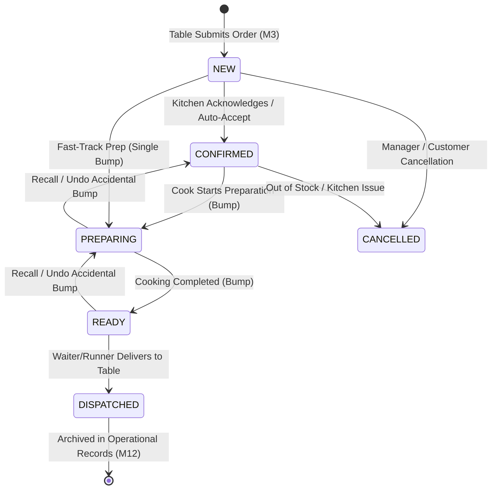
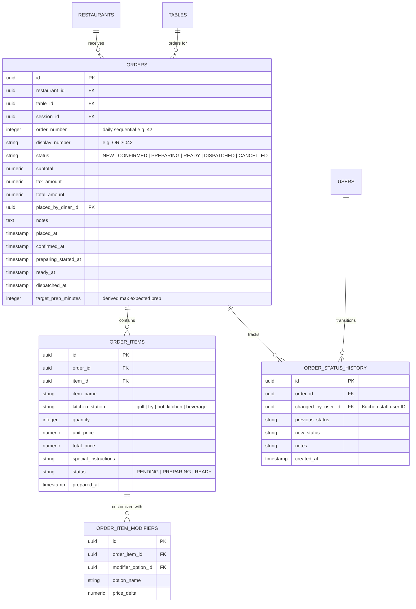
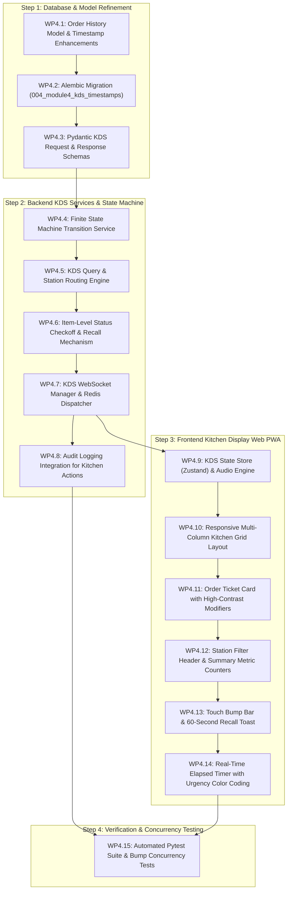

# MezFlow — Module 4: Kitchen Display System (KDS) & Order Processing Pipeline
## Implementation Plan (`M4_implementation_plan.md`)

- **Project:** MezFlow — Real-Time Restaurant Dining and Kitchen Operations Management System
- **Module ID:** M4 (Kitchen Display System & Order Processing Pipeline)
- **Phase:** FYP-I (Core Kitchen Operations Loop)
- **Owners:** Talha Mumtaz (Backend Real-Time Services, KDS State Engine & Concurrency) & Syed Sail Haider Gardezi (Touch-Optimized Kitchen UI/UX) & Sheikh Muhammad Khizar (Architecture & Lifecycle Integration)
- **Document Version:** 1.0
- **Target Location:** `Docs/Plan/M4_implementation_plan.md`
- **SRS Requirements Covered:** `FR-M4-01` through `FR-M4-08` (Single-Screen KDS PWA, Independent Order Cards, Status & Station Filtering, State Machine Transitions, Item-Level Bumping, Reversible Recall, Urgency Delay Timers, Audio/Visual Alerts)
- **Traceability:** `FR-M5-01` (Order Lifecycle State Machine), `FR-M6-01` (Prep-Time Tracking & Delay Detection), `NFR-01` (First Load < 3s), `NFR-02` (Real-Time Propagation < 2s), `NFR-03` ($\ge 50$ WebSocket Connections), `NFR-07` (RBAC Staff Security), `NFR-08` (Multi-Tenant Isolation), `NFR-11` (SUS Usability $\ge 70$), `NFR-15` (Zero-Install Hardware-Agnostic Web Display).

---

## 1. Module Overview & Goals

Module 4 delivers the operational core of the kitchen: the **Kitchen Display System (KDS)**. In traditional dining restaurants, noisy, lost, or greasy paper tickets create communication bottlenecks between waitstaff and chefs, causing dish delays and forgotten modifications. MezFlow replaces physical printers with a synchronized, high-contrast, touch-optimized web application running on any standard browser (tablets, touchscreens, wall monitors, or laptops) without proprietary hardware (`[6, 7]`).

When a table places an order in Module 3, it pops up immediately on the KDS within $< 2$ seconds (`NFR-02`). Line cooks and expediters view table numbers, diner names, dish quantities, highlighted modifier choices (e.g. `Mild`, `Extra Cheese`), and special instructions (e.g. `No onions`). Chefs can filter by cooking station (`Grill`, `Fry`, `Hot Kitchen`, `Beverage`), advance orders through a strictly validated state machine, and track elapsed preparation times with color-coded delay alerts.

```
Table Cart Submitted (M3)
          │
          ▼
[Redis Pub/Sub: channel:kds:{restaurant_id}]
          │
          ▼  (< 2s latency)
┌─────────────────────────────────────────────────────────────────────────────┐
│                       KITCHEN DISPLAY SYSTEM (M4 KDS)                       │
│  [Station Filter: All | Grill | Fry | Hot Kitchen | Beverage]               │
│  [Status Filter:  All | New | Preparing | Ready | Delayed]                  │
│                                                                             │
│  ┌───────────────────────┐  ┌───────────────────────┐  ┌──────────────────┐ │
│  │ ORD-042 • Table 4     │  │ ORD-043 • Table 8     │  │ ORD-041 • Table 2│ │
│  │ 🟢 04:12 mins         │  │ 🟡 11:45 mins         │  │ 🔴 18:30 (DELAYED│ │
│  │───────────────────────│  │───────────────────────│  │──────────────────│ │
│  │ 2x Smash Beef Burger  │  │ 1x Garlic Wings (Fry) │  │ 1x Shinwari (Hot)│ │
│  │    + Extra Cheddar    │  │ 1x Mint Lemonade (Bev)│  │    • Less spicy  │ │
│  │ 1x Chicken Tikka (Gril│  │                       │  │                  │ │
│  │───────────────────────│  │───────────────────────│  │──────────────────│ │
│  │ [ Bump to Preparing ] │  │ [ Bump to Ready ]     │  │ [ Recall / Bump ]│ │
│  └───────────────────────┘  └───────────────────────┘  └──────────────────┘ │
└─────────────────────────────────────────────────────────────────────────────┘
          │ (Single Tap Bump)
          ▼
[State Machine Transition: PREPARING ➔ READY]
          │
          ├─────────────────────────────────────────┐
          ▼                                         ▼
Customer PWA Timeline (M3)               Service Staff Notification
("Order is ready to serve!")             ("Table 4 ready for runner!")
```

### Core Objectives:
1. **Zero-Install Hardware-Agnostic Web KDS (`FR-M4-01`, `NFR-15`)**:
   - Runs in any modern browser on low-cost Android/iPad tablets, wall-mounted touch monitors, or laptops without specialized hardware.
   - Responsive multi-column grid adapting from 2 columns on 10" tablets to 4–6 columns on 24"+ commercial kitchen monitors.
2. **Card-Based Order Queue with Full Customization Visibility (`FR-M4-02`)**:
   - Each active order renders as an independent card with order number (`ORD-042`), table number, placing diner name, order notes, dish items, and quantities.
   - Modifiers and ingredient removals rendered with high-contrast badge styling so modifications are never missed during peak rushes.
3. **Station-Based Routing & Multi-View Filtering (`FR-M4-04`)**:
   - Filters orders by station: `Grill`, `Fry`, `Hot Kitchen`, `Beverage`, `Dessert`, or `All Stations` (Expediter View).
   - Allows dedicated station cooks to see only their assigned dishes, or highlights station-specific items on master cards.
4. **Finite Order State Machine & One-Tap Bumping (`FR-M4-05`, `FR-M5-01`)**:
   - Governed by an immutable state machine: `NEW` $\rightarrow$ `CONFIRMED` $\rightarrow$ `PREPARING` $\rightarrow$ `READY` $\rightarrow$ `DISPATCHED` (or `CANCELLED`).
   - One-tap "Bump Bar" action moves orders forward.
   - "Undo / Recall" action allows reverting an accidental bump within a configurable window (e.g., 60 seconds).
5. **Real-Time WebSocket Synchronization & Audio/Visual Chimes (`FR-M4-06`, `NFR-02`)**:
   - Consumes `channel:kds:{restaurant_id}` over WebSocket `/ws/kds/{restaurant_id}`.
   - New orders trigger a visual highlight animation and synthesized audio chime alert.
   - Pushes state changes to customer PWA and service staff without page reloads.
6. **Elapsed Preparation Timers & Delay Detection (`FR-M4-07`, `FR-M6-01`)**:
   - Live elapsed minute counter computed from `placed_at`.
   - Color-coded urgency thresholds:
     - 🟢 Normal ($< 10$ mins)
     - 🟡 Warning ($10 - 15$ mins)
     - 🔴 Delayed ($> 15$ mins or exceeding configured `expected_prep_minutes`).
7. **Kitchen Staff RBAC & Secure Multi-Tenancy (`FR-M4-08`, `NFR-07`, `NFR-08`)**:
   - Restricted to `Kitchen Staff`, `Service Staff`, and `Manager` roles via JWT authentication.
   - Complete restaurant tenant isolation and append-only audit trail logging for all status transitions (`FR-M1-06`).

---

## 2. Order Lifecycle State Machine & Architecture



### State Machine Transition Rules:

| Current State | Allowed Next States | Trigger Action | Authorized Roles | Real-Time Notifications Dispatched |
| :--- | :--- | :--- | :--- | :--- |
| `NEW` | `CONFIRMED`, `PREPARING`, `CANCELLED` | Cook taps "Start" or "Acknowledge" | Kitchen, Manager | Customer PWA ("Order Confirmed"), KDS Card Border turns Blue |
| `CONFIRMED` | `PREPARING`, `CANCELLED` | Cook taps "Prepare" | Kitchen, Manager | Customer PWA ("Preparing"), Station Cook alerted |
| `PREPARING` | `READY`, `CONFIRMED` (Recall) | Cook taps "Bump to Ready" | Kitchen, Manager | Customer PWA ("Order Ready!"), Service Staff PWA notification |
| `READY` | `DISPATCHED`, `PREPARING` (Recall) | Runner picks up & marks delivered | Service, Cashier, Manager | Customer PWA ("Food Served"), Order cleared from active KDS |
| `DISPATCHED` | *Terminal State* | Table completes dining | System / Billing (M8) | Order archived for Analytics (M12) |
| `CANCELLED` | *Terminal State* | Manager cancels order | Manager Only | Customer PWA ("Cancelled"), Audit log recorded (`FR-M1-06`) |

---

## 3. Database Schema (M4 Verification & Enhancements)

The underlying relational tables (`orders`, `order_items`, `order_item_modifiers`) were scaffolded in Module 3. Module 4 adds performance indexes, status timestamps, and chef attribution.



---

## 4. API & WebSocket Contract Specification (M4 Endpoints)

All KDS endpoints require staff authentication via HTTP Bearer JWT token (`require_roles([KITCHEN_STAFF, SERVICE_STAFF, MANAGER])`).

### 4.1 REST Endpoints

| Method | Endpoint | Query / Body Params | Purpose & Response |
| :--- | :--- | :--- | :--- |
| `GET` | `/api/v1/kds/orders/active` | Query: `station` (`all`\|`grill`\|`fry`\|`hot_kitchen`\|`beverage`), `status` (`all`\|`new`\|`preparing`\|`ready`) | **Fetch Active Kitchen Queue**: Returns list of active orders (`NEW`, `CONFIRMED`, `PREPARING`, `READY`) with nested items, modifiers, table numbers, and elapsed prep seconds. |
| `GET` | `/api/v1/kds/summary` | Query: `station` (optional) | **KDS Metric Counter**: Returns counts of active tickets: `{ "new": 3, "preparing": 5, "ready": 2, "delayed": 1, "avg_prep_mins": 13.4 }`. |
| `PATCH` | `/api/v1/kds/orders/{order_id}/bump` | Body: `{ target_status?: string }` | **Single-Tap Bump**: Advances order to next logical state (`NEW` $\rightarrow$ `PREPARING` $\rightarrow$ `READY`). Emits audit log and broadcasts to `/ws/kds` and `/ws/sessions`. |
| `POST` | `/api/v1/kds/orders/{order_id}/recall` | Body: `{ reason?: string }` | **Undo / Recall Action**: Reverts order to previous state within a 60-second window. |
| `PATCH` | `/api/v1/kds/orders/{order_id}/items/{item_id}/status` | Body: `{ status: "PENDING" | "PREPARING" | "READY" }` | **Item-Level Checkoff**: Line cook marks specific dish ready without closing entire table ticket. |
| `GET` | `/api/v1/kds/orders/history` | Query: `limit=20`, `offset=0` | **Recently Completed Orders**: View dispatched/completed orders for shift review. |

---

### 4.2 Real-Time WebSocket Channel Specification

**WebSocket Endpoint:** `/ws/kds/{restaurant_id}` (and fallback `/api/v1/ws/kds/{restaurant_id}`)  
**Authentication:** Query param `?token={jwt_token}` (validated against `require_roles([KITCHEN_STAFF, SERVICE_STAFF, MANAGER])`)  
**Redis Channel Pattern:** `channel:kds:{restaurant_id}`

#### Client-Bound Events (Server $\rightarrow$ Kitchen Screen):

1. **`NEW_ORDER`**:
   ```json
   {
     "event": "NEW_ORDER",
     "restaurant_id": "52dc0556-c8c6-4131-be96-6643f9cc35b0",
     "order": {
       "id": "7b8a3e12-4c56-4d78-9e01-2f3a4b5c6d7e",
       "order_number": 42,
       "display_number": "ORD-042",
       "table_number": 4,
       "table_name": "Table 4",
       "status": "NEW",
       "total_amount": 3790.0,
       "placed_at": "2026-10-22T18:20:00Z",
       "target_prep_minutes": 20,
       "notes": "Please hurry, kids are hungry",
       "items": [
         {
           "id": "item-1",
           "item_name": "Smash Beef Burger",
           "kitchen_station": "grill",
           "quantity": 2,
           "special_instructions": "Well done",
           "status": "PENDING",
           "modifiers": ["Extra Cheddar Cheese (+150)"]
         },
         {
           "id": "item-2",
           "item_name": "Crispy Garlic Wings",
           "kitchen_station": "fry",
           "quantity": 1,
           "special_instructions": null,
           "status": "PENDING",
           "modifiers": []
         }
       ]
     }
   }
   ```
2. **`ORDER_BUMPED`**:
   ```json
   {
     "event": "ORDER_BUMPED",
     "order_id": "7b8a3e12-4c56-4d78-9e01-2f3a4b5c6d7e",
     "order_number": 42,
     "previous_status": "NEW",
     "new_status": "PREPARING",
     "updated_at": "2026-10-22T18:22:15Z",
     "bumped_by": "Chef Talha"
   }
   ```
3. **`ITEM_STATUS_UPDATED`**:
   ```json
   {
     "event": "ITEM_STATUS_UPDATED",
     "order_id": "7b8a...",
     "item_id": "item-1",
     "status": "READY",
     "kitchen_station": "grill"
   }
   ```
4. **`ORDER_RECALLED`**:
   ```json
   {
     "event": "ORDER_RECALLED",
     "order_id": "7b8a...",
     "reverted_to_status": "PREPARING",
     "updated_at": "2026-10-22T18:25:00Z"
   }
   ```

---

## 5. Implementation Steps & Work Packages



---

### Step 1: Database & Model Refinement

#### WP4.1: Order History Model & Timestamp Enhancements
- Extend `backend/app/models/order.py`:
  - Add lifecycle milestone columns to `Order`: `confirmed_at`, `preparing_started_at`, `ready_at`, `dispatched_at`.
  - Add `target_prep_minutes` (derived maximum prep time across ordered dishes).
  - Create `OrderStatusHistory` model to record timestamp, previous status, new status, and `changed_by_user_id` FK.
- Update `backend/app/models/__init__.py`.

#### WP4.2: Alembic Migration (`004_module4_kds_timestamps`)
- Generate migration script adding milestone columns and `order_status_history` table with indexes on `(order_id, created_at)`.
- Execute `alembic upgrade head`.

#### WP4.3: Pydantic KDS Request & Response Schemas
- Create `backend/app/schemas/kds.py`:
  - `KDSItemResponse`: dish name, quantity, station, special instructions, modifiers list, item status.
  - `KDSOrderCardResponse`: order ID, display number, table number, table name, status, elapsed seconds, urgency level, target prep minutes, items list, notes.
  - `KDSSummaryResponse`: active counts grouped by status (`new`, `preparing`, `ready`, `delayed`) and station breakdown.
  - `BumpOrderRequest`: optional target status override and kitchen station context.
  - `ItemStatusUpdateRequest`: target item status (`PENDING`, `PREPARING`, `READY`).
  - `RecallOrderRequest`: optional explanation note.

---

### Step 2: Backend KDS Services & State Machine

#### WP4.4: Finite State Machine Transition Service
- Create `backend/app/services/kds_service.py`:
  - Implements strict validator `validate_status_transition(current_status, target_status)`.
  - Rejects illegal transitions (e.g. `NEW` $\rightarrow$ `DISPATCHED` directly, or mutating a `CANCELLED` order) with `400 Bad Request`.
  - Sets appropriate milestone timestamp (`preparing_started_at`, `ready_at`, `dispatched_at`).
  - Records row in `order_status_history`.

#### WP4.5: KDS Query & Station Routing Engine
- In `kds_service.py`:
  - `get_active_kds_orders(restaurant_id, station_filter, status_filter)`:
    - Efficient async query fetching all non-terminal orders (`status != DISPATCHED` and `status != CANCELLED`).
    - Filters items by station if specific station view is requested.
    - Computes `elapsed_seconds = now() - placed_at`.
    - Labels tickets `NORMAL`, `WARNING`, or `DELAYED`.
  - `get_kds_summary_metrics(restaurant_id)`:
    - Fast aggregated counts for top bar badges.

#### WP4.6: Item-Level Status Checkoff & Recall Mechanism
- In `kds_service.py`:
  - `update_order_item_status(order_id, item_id, new_status)`:
    - Sets individual item status (`READY`).
    - If all items in an order are marked `READY`, automatically bumps the parent order to `READY`.
  - `recall_order(order_id, user_id)`:
    - Checks if last transition occurred within grace period ($\le 60$ seconds).
    - Reverts order to previous status recorded in `order_status_history`.

#### WP4.7: KDS WebSocket Manager & Redis Dispatcher
- Update `backend/app/services/realtime.py`:
  - Add `KDSConnectionManager` handling staff WebSocket connections at `/ws/kds/{restaurant_id}`.
  - Automatically bridges all order bump events to `channel:kds:{restaurant_id}` and `channel:session:{session_id}` (customer notification sync).

#### WP4.8: Audit Logging Integration
- Connect `record_audit_log` from `backend/app/services/audit.py` on every bump and recall with action `KDS_ORDER_BUMP` and `KDS_ORDER_RECALL`.

---

### Step 3: Frontend Kitchen Display Web PWA

#### WP4.9: KDS State Store (Zustand) & Audio Engine
- Create `frontend/src/lib/kdsStore.ts`:
  - Manages active orders array, station filter (`all`, `grill`, `fry`, `hot_kitchen`, `beverage`), status filter, sound toggle, and metric counters.
- Create `frontend/src/lib/audioAlerts.ts`:
  - Web Audio API synthesizer generating a pleasant, piercing two-tone kitchen chime (880Hz $\rightarrow$ 1320Hz) on `NEW_ORDER` events without requiring external MP3 assets.

#### WP4.10: Responsive Multi-Column Kitchen Grid Layout
- Update `frontend/src/app/(kds)/kds/page.tsx`:
  - High-contrast, dark-mode kitchen viewport (`bg-slate-950`).
  - Auto-adjusting CSS grid: 2 columns on small tablets, 3 on standard screens, 4–5 on wide kitchen monitors.
  - Sticky header bar with station selector, active summary chips, sound toggle, and connection heartbeat status.

#### WP4.11: Order Ticket Card Component
- Create `frontend/src/components/kds/OrderTicketCard.tsx`:
  - Card header: bold order number (`#042`), table badge (`Table 4`), placing diner name.
  - Timer header: live dynamic counter with pulsating urgency dot.
  - Item list: large readable dish names, bold quantities (e.g. `2x`), station icon tag.
  - Customization callouts: prominent amber badges for added modifiers (e.g. `+ Extra Cheese`) and red badges for removals (e.g. `NO MAYO`, `NO ONIONS`).
  - Customer special instructions callout box.
  - Item checkoff toggle: tap any item to strike through as done.

#### WP4.12: Station Filter Header & Summary Metric Counters
- Create `frontend/src/components/kds/StationFilterBar.tsx`:
  - Large touch tabs: `All Stations`, `🥩 Grill`, `🍟 Fry`, `🍲 Hot Kitchen`, `🥤 Beverage`.
  - Pill badges displaying live pending count per station.

#### WP4.13: Touch Bump Bar & 60-Second Recall Toast
- Create `frontend/src/components/kds/BumpBar.tsx`:
  - Giant touch-target button ($\ge 56$px height) spanning card footer:
    - If `NEW`: Blue button $\rightarrow$ "Start Preparing"
    - If `PREPARING`: Amber button $\rightarrow$ "Mark Ready for Pickup"
    - If `READY`: Emerald button $\rightarrow$ "Dispatch / Delivered"
  - Floating "Undo Bump" snackbar toast giving chefs 60 seconds to undo an accidental bump.

#### WP4.14: Real-Time Elapsed Timer with Urgency Color Coding
- Create `frontend/src/hooks/useElapsedTimer.ts`:
  - Local 1-second interval re-calculating elapsed minutes for every active ticket.
  - Dynamic card styling classes:
    - `border-slate-800` (Normal, $< 10$ mins)
    - `border-amber-500/80 bg-amber-500/5` (Warning, $10 - 15$ mins)
    - `border-rose-500 bg-rose-500/10 animate-pulse` (Delayed, $> 15$ mins or $>$ target prep time).

---

### Step 4: Verification & Concurrency Testing

#### WP4.15: Automated Pytest Suite & Bump Concurrency Tests
- Create `backend/tests/test_kds.py`:
  - Active orders query with station filtering.
  - State machine transition validation (`NEW` $\rightarrow$ `PREPARING` $\rightarrow$ `READY` $\rightarrow$ `DISPATCHED`).
  - Rejection of invalid transitions (e.g. cannot jump from `NEW` to `DISPATCHED`).
  - Recall action within 60 seconds and rejection after expiration.
  - Concurrency test: multiple kitchen stations bumping items concurrently without race conditions.
  - Role protection verification (Customers rejected with `403 Forbidden`).

---

## 6. Hardware Compatibility, Kitchen UX & Offline Resilience

### 6.1 Kitchen Ergonomics & Touch Targets
- Kitchen environments are fast-paced, high-heat, and hands are often wet or wearing gloves:
  - **Minimum Touch Target**: All interactive controls (Bump button, station pills, item checkoff) have minimum dimension $\ge 48 \times 48$px.
  - **High-Contrast Dark Surface**: Slate-950 background with crisp white typography (`text-white`) and vivid semantic accents (Amber, Emerald, Rose) to eliminate glare under kitchen fluorescent lighting.
  - **Grease & Splash Resistance**: Large cards that do not require pinch-to-zoom or intricate swipe gestures. Single distinct taps advance cards.

### 6.2 Browser & Device Compatibility (`NFR-15`)
- Zero proprietary POS hardware required. Fully compatible with:
  - Apple iPad (Safari, iOS 14+)
  - Android commercial touch panels & budget tablets (Chrome 90+)
  - Windows/Linux touch-monitor all-in-ones (Edge, Chrome, Firefox)
  - Wall-mounted TVs running via Raspberry Pi or HDMI micro-PC.

### 6.3 Flaky Wi-Fi & Offline Recovery (`NFR-02`, `NFR-24`)
- Kitchen corners frequently suffer from RF interference from stainless steel appliances and microwave ovens:
  - Automatic WebSocket reconnect with exponential backoff ($1\text{s}, 2\text{s}, 4\text{s}, 8\text{s}$).
  - Persistent ping/pong heartbeat every 15 seconds.
  - On reconnection, the client automatically re-fetches `GET /api/v1/kds/orders/active` to resynchronize active tickets.

---

## 7. Verification Matrix & Acceptance Test Cases

| Test ID | Objective | Test Steps | Expected Result |
| :--- | :--- | :--- | :--- |
| `TEST-M4-01` | **Active KDS Queue Load** | Seed orders with status `NEW`, `PREPARING`, `READY`, and `DISPATCHED`. Authenticated kitchen staff requests `GET /api/v1/kds/orders/active`. | Returns active orders with nested items, modifiers, and table number; excludes `DISPATCHED` orders. |
| `TEST-M4-02` | **Real-Time New Order Arrival** | Table submits order via Module 3. Connected KDS client listens on `/ws/kds/{restaurant_id}`. | `NEW_ORDER` event received within $< 2$ seconds. New ticket card mounts with audio chime alert. |
| `TEST-M4-03` | **State Transition: Bump to Preparing** | Chef triggers `PATCH /kds/orders/{id}/bump` from `NEW`. | Order status changes to `PREPARING`. Card border updates to amber; customer PWA receives live status update. |
| `TEST-M4-04` | **State Transition: Bump to Ready** | Chef triggers second bump from `PREPARING`. | Status updates to `READY`. `ready_at` timestamp recorded. Service staff alerted for table delivery. |
| `TEST-M4-05` | **Invalid Transition Rejection** | Client attempts to transition order directly from `NEW` to `DISPATCHED`. | Backend rejects with `400 Bad Request ("Invalid state transition from NEW to DISPATCHED")`. |
| `TEST-M4-06` | **60-Second Recall Action** | Chef bumps order to `READY` by mistake, immediately clicks "Undo / Recall" within 10 seconds. | Order status successfully reverts to `PREPARING`. Ticket reappears in active cooking queue. |
| `TEST-M4-07` | **Station Filtering Isolation** | Filter KDS to `Grill Station`. Order contains 1x Smash Burger (Grill) and 1x Lemonade (Beverage). | Grill view displays only Burger; Beverage station displays Lemonade. |
| `TEST-M4-08` | **Staff Role Protection & Tenant Isolation** | Customer token or staff from Restaurant B attempts to access Restaurant A's KDS endpoint. | Customer receives `403 Forbidden`; cross-restaurant staff receives `403 Forbidden`. |

---

## 8. Definition of Done (DoD) for Module 4

Module 4 is complete and ready for production kitchen deployment when:
- [ ] Active orders placed from table sessions appear automatically on the KDS screen in $< 2$ seconds without manual refresh.
- [ ] Order cards render order numbers, table numbers, item quantities, emphasized modifier additions, and ingredient removals.
- [ ] Kitchen staff can filter tickets by station (`All`, `Grill`, `Fry`, `Hot Kitchen`, `Beverage`) and by status.
- [ ] Single-tap Bump action transitions orders strictly through the state machine (`NEW` $\rightarrow$ `PREPARING` $\rightarrow$ `READY` $\rightarrow$ `DISPATCHED`).
- [ ] 60-second Recall action successfully reverts accidental bumps.
- [ ] Live elapsed timer tracks cooking time with color-coded alerts (Normal $\rightarrow$ Warning $\rightarrow$ Delayed).
- [ ] Real-time updates propagate across kitchen display, diner mobile PWA, and staff consoles.
- [ ] Touch targets ($\ge 48$px) and high-contrast dark theme are verified on tablet and desktop viewports.
- [ ] Automated test suite in `backend/tests/test_kds.py` passes with 100% success rate.
