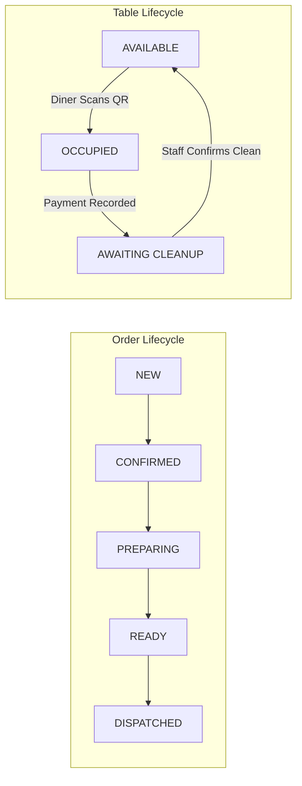

# MezFlow — Real-Time Restaurant Dining & Kitchen Operations Management System

> **A synchronized, zero-install web platform connecting customer ordering, single-screen kitchen display operations, and table lifecycle management for small and medium size restaurants.**

---

## 📌 Project Overview

**MezFlow** is a Final Year Project for the BS Software Engineering (BSSE) degree at **SZABIST Islamabad**, supervised by **Muhammad Farooq**.

In many small and medium dine-in restaurants, operations still rely on printed menus, verbal communication, handwritten or thermal ticket queues, and fragmented POS software. MezFlow eliminates these operational bottlenecks with an integrated, hardware-agnostic, real-time platform:

1. **Zero-Install Collaborative Table Ordering (PWA):** Customers scan a QR code at their table to browse the menu and join a shared live cart with fellow diners on their mobile browser—without installing any app.
2. **Single-Screen Kitchen Display System (KDS):** Replaces paper tickets with a browser-based digital order queue equipped with station filters (Grill, Fry, Hot Kitchen, Beverage) and automated preparation delay flags.
3. **Decoupled Table Lifecycle Engine:** Models digital session closure (payment) independently from physical table readiness (staff-confirmed cleanup) to optimize peak-hour table turnover.
4. **Grounded AI Dish Explanation:** Answers diner menu queries in English or Urdu using strictly restaurant-provided structured data (flavor, heat level, portion, ingredients) without hallucination.

---

## 📚 Project Documentation & Plans

Detailed system documentation and engineering plans are maintained under the [`Docs/`](./Docs) directory:

| Document | Description |
| :--- | :--- |
| **[Chapter 1: Introduction](./Docs/MezFlow-FYP-Chapter1-v5.pdf)** | Problem statement, 10-application market comparison, project objectives, and software process model. |
| **[Chapter 2: SRS](./Docs/MezFlow_Chapter2_SRS.pdf)** | Formal Software Requirements Specification covering all 12 modules (`FR-M1` to `FR-M12`) and non-functional requirements (`NFR-01` to `NFR-18`). |
| **[FYP Proposal](./Docs/MezFlow_FYP_Proposal%201.pdf)** | Original project proposal, work plan, and architectural vision. |
| **[Module 0 Plan](./Docs/Plan/M0_implementation_plan.md)** | Baseline scaffolding, Docker configuration, FastAPI app factory, and Next.js setup. |
| **[Module 1 Plan](./Docs/Plan/M1_implementation_plan.md)** | Identity & Access Control plan (JWT, OTP login, RBAC across 5 roles, multi-tenant isolation). |

---

## 🛠 Tech Stack

Built entirely on modern, open-source frameworks and standard web protocols:

* **Frontend:** Next.js (React), TypeScript, Tailwind CSS (Mobile-First Customer PWA, Kitchen Display, and Management Console).
* **Backend API:** Python 3.11+, FastAPI (RESTful endpoints and RFC 6455 WebSockets).
* **Database & ORM:** PostgreSQL 16, SQLAlchemy 2.0 (async), Alembic migrations.
* **Authentication & Security:** JWT (JSON Web Tokens), bcrypt hashing, Role-Based Access Control (RBAC), multi-tenant Row-Level Security (RLS).
* **DevOps & Infrastructure:** Docker, Docker Compose, Nginx reverse proxy, GitHub Actions CI/CD.
* **Testing:** `pytest`, `pytest-asyncio`, `httpx`, `Locust` (for concurrency & load testing).

---

## 🧩 The 12 Functional Modules

| Module ID | Module Name | Phase | Scope Summary |
| :---: | :--- | :---: | :--- |
| **M1** | **Identity & Access Control** | FYP-I | Signup/login (OTP & password), JWT sessions, 5 roles, tenant isolation, and audit log. |
| **M2** | **Digital Menu & QR Table Access** | FYP-I | Unique QR per table, mobile PWA menu, live pricing/availability, structured modifiers. |
| **M3** | **Collaborative Table Ordering** | FYP-I | Multi-diner shared table session, live cart sync with per-diner attribution, single order submission. |
| **M4** | **Kitchen Display System (KDS)** | FYP-I | Browser-based order card queue, category/station routing, status progression. |
| **M5** | **Order Lifecycle & Real-Time Sync** | FYP-II | WebSocket event propagation (<2s latency), automatic reconnect, and REST fallback. |
| **M6** | **Prep-Time Tracking & Delay Detection**| FYP-II | Configurable item prep times, automatic elapsed timers, visual delay flags on KDS. |
| **M7** | **AI-Assisted Dish Explanation** | FYP-II | Grounded LLM dish explanations strictly from restaurant metadata (English & Urdu). |
| **M8** | **Billing & Payment Workflow** | FYP-I/II | *FYP-I*: Data models & server-side price validation.  *FYP-II*: Bill request flow, cashier payment recording, session closure. |
| **M9** | **Table Lifecycle Management** | FYP-II | Independent state machine (`Available` → `Occupied` → `Awaiting Cleanup` → `Available`). |
| **M10** | **Management Console** | FYP-II | Admin UI for menu management, table/QR generation, staff roles, and restaurant settings. |
| **M11** | **Service Requests & Notifications** | FYP-II | In-app diner requests (waiter call, water refill), prioritized service queue, push alerts. |
| **M12** | **Analytics & Operational Records** | FYP-II | Analytics dashboard (orders, prep times, delay rates), CSV export, immutable audit logs. |

---

## 🔄 Dual Independent State Machines

A core differentiator of MezFlow is that paying a bill does **not** assume a table is physically clean and available:

---

## 👥 Authors & Team Structure

* **Sheikh Muhammad Khizar** (2380227) — Full-Stack Developer
  * *Areas:* Backend Architecture, M1 (Identity & Access), M5 (Order Lifecycle & Sync), M8 (Billing & Payment), M7 (AI Module), M10 (Management Console), M12 (Analytics & Audit), QA.
* **Talha Mumtaz** (2380700) — Backend Developer
  * *Areas:* Database Design, Real-time services, M4 (Kitchen Display System), M6 (Prep-Time Tracking), M11 (Service Requests & Notifications), Concurrency Testing.
* **Syed Sail Haider Gardezi** (2380245) — Frontend Developer
  * *Areas:* UI/UX Design, M2 (Digital Menu & QR Access), M3 (Collaborative Table Ordering), M9 (Table Lifecycle Management), Customer PWA implementation.

**Supervised by:** Muhammad Farooq  
**Department of Computer Science**, Shaheed Zulfikar Ali Bhutto Institute of Science and Technology (SZABIST), Islamabad Campus.
